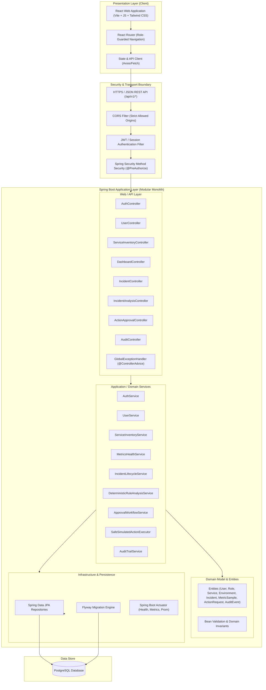

# ForgeOps Architecture Specification

## 1. System Overview

ForgeOps is an enterprise-grade simulated operations platform designed to manage service inventories, monitor health metrics, coordinate incident investigations, and safely execute operational remediation through deterministic AI-assisted proposals and mandatory human approvals.

The platform follows a **Modular Monolith** architecture:
- **Frontend**: Single-Page Application (SPA) built with React and Vite (JavaScript), communicating with the backend over REST JSON.
- **Backend**: Spring Boot 3.x application with clean layer separation (Web/Controller, Application/Service, Domain, Infrastructure/Repository).
- **Persistence**: Relational PostgreSQL database managed via Flyway versioned migrations.
- **Rule-Based Assistant**: Embedded, deterministic analysis engine running fully in-process and offline with zero external network or third-party API dependencies.



---

## 2. Architectural Boundaries and Principles

1. **Strict Layer Separation**:
   - **Controllers**: Strictly protocol adapters. Perform HTTP parsing, delegate to services, map domain outcomes to HTTP status codes, and return Response DTOs. Zero business logic.
   - **Services**: Enforce domain rules, coordinate transactions (`@Transactional`), manage authorization gates, and emit immutable audit events.
   - **Domain / Entities**: Encapsulate data and invariants. Database entities are never exposed across the REST interface.
   - **Repositories**: Encapsulate relational queries via Spring Data JPA and parameterized queries.
2. **Deterministic Offline AI Assistant**:
   - The "AI" assistant is implemented via an extensible Java service interface (`IncidentAnalysisService`).
   - Uses local deterministic decision trees and metric correlation rules.
   - Never issues outbound HTTP calls, requires no API tokens, and guarantees reproducible recommendations for identical input states.
3. **Strict Separation of Recommendation, Approval, and Execution**:
   - The analysis service generates *proposals* (`ActionProposalDTO`).
   - The engineer converts a proposal into a *pending request* (`ActionRequestEntity` with status `PENDING_APPROVAL`).
   - An authorized *approver* reviews the request and either approves or rejects it with required audit comments.
   - A distinct *execution step* validates that the request is `APPROVED`, verifies actor permissions, ensures idempotency, and executes the simulated action without modifying real host or cloud infrastructure.
4. **Append-Only Audit Trail**:
   - Security-critical operations (login, incident updates, action creation, approval, execution) synchronously generate structured audit events.
   - Audit records are immutable; no update or delete endpoints exist.

---

## 3. Package Structure

```text
com.forgeops
├── ForgeOpsApplication.java
├── config
│   ├── ApplicationConfig.java
│   ├── OpenApiConfig.java
│   └── WebMvcConfig.java
├── security
│   ├── SecurityConfig.java
│   ├── JwtTokenProvider.java
│   ├── JwtAuthenticationFilter.java
│   ├── UserPrincipal.java
│   └── CustomUserDetailsService.java
├── common
│   ├── dto
│   │   ├── ApiResponse.java
│   │   ├── ErrorResponse.java
│   │   └── PagedResponse.java
│   ├── exception
│   │   ├── ResourceNotFoundException.java
│   │   ├── InvalidStateTransitionException.java
│   │   ├── AccessDeniedException.java
│   │   ├── BusinessRuleException.java
│   │   └── GlobalExceptionHandler.java
│   └── audit
│       └── AuditActionType.java
├── auth
│   ├── AuthController.java
│   ├── AuthService.java
│   └── dto
│       ├── LoginRequest.java
│       ├── AuthResponse.java
│       └── CurrentUserResponse.java
├── user
│   ├── UserEntity.java
│   ├── RoleEntity.java
│   ├── RoleName.java (VIEWER, ENGINEER, APPROVER, ADMIN)
│   ├── UserRepository.java
│   ├── RoleRepository.java
│   ├── UserService.java
│   └── UserController.java
├── serviceinventory
│   ├── ServiceEntity.java
│   ├── EnvironmentEntity.java
│   ├── Criticality.java
│   ├── LifecycleStatus.java
│   ├── ServiceRepository.java
│   ├── EnvironmentRepository.java
│   ├── ServiceInventoryService.java
│   ├── ServiceInventoryController.java
│   └── dto
├── metrics
│   ├── MetricSampleEntity.java
│   ├── MetricType.java (CPU, MEMORY, LATENCY, ERROR_RATE)
│   ├── MetricSampleRepository.java
│   ├── MetricsHealthService.java
│   └── dto
├── dashboard
│   ├── DashboardService.java
│   ├── DashboardController.java
│   └── dto
├── incident
│   ├── IncidentEntity.java
│   ├── IncidentNoteEntity.java
│   ├── IncidentSeverity.java (SEV1, SEV2, SEV3, SEV4)
│   ├── IncidentStatus.java (OPEN, INVESTIGATING, MITIGATED, RESOLVED)
│   ├── IncidentRepository.java
│   ├── IncidentNoteRepository.java
│   ├── IncidentLifecycleService.java
│   ├── IncidentController.java
│   └── dto
├── ai
│   ├── IncidentAnalysisService.java
│   ├── RuleBasedIncidentAnalysisService.java
│   ├── IncidentAnalysisEntity.java
│   ├── IncidentAnalysisRepository.java
│   ├── IncidentAnalysisController.java
│   └── dto
│       ├── AnalysisRequest.java
│       ├── AnalysisResultDTO.java
│       └── ProposedActionDTO.java
├── approval
│   ├── ActionRequestEntity.java
│   ├── ActionType.java (MARK_SERVICE_MAINTENANCE, CLEAR_DEMO_ALERT, RESTART_DEMO_SERVICE)
│   ├── ApprovalStatus.java (PENDING_APPROVAL, APPROVED, REJECTED, EXECUTED, FAILED)
│   ├── ActionRequestRepository.java
│   ├── ApprovalWorkflowService.java
│   ├── ActionApprovalController.java
│   ├── SafeSimulatedActionExecutor.java
│   └── dto
└── audit
    ├── AuditEventEntity.java
    ├── AuditEventRepository.java
    ├── AuditTrailService.java
    ├── AuditController.java
    └── dto
```
