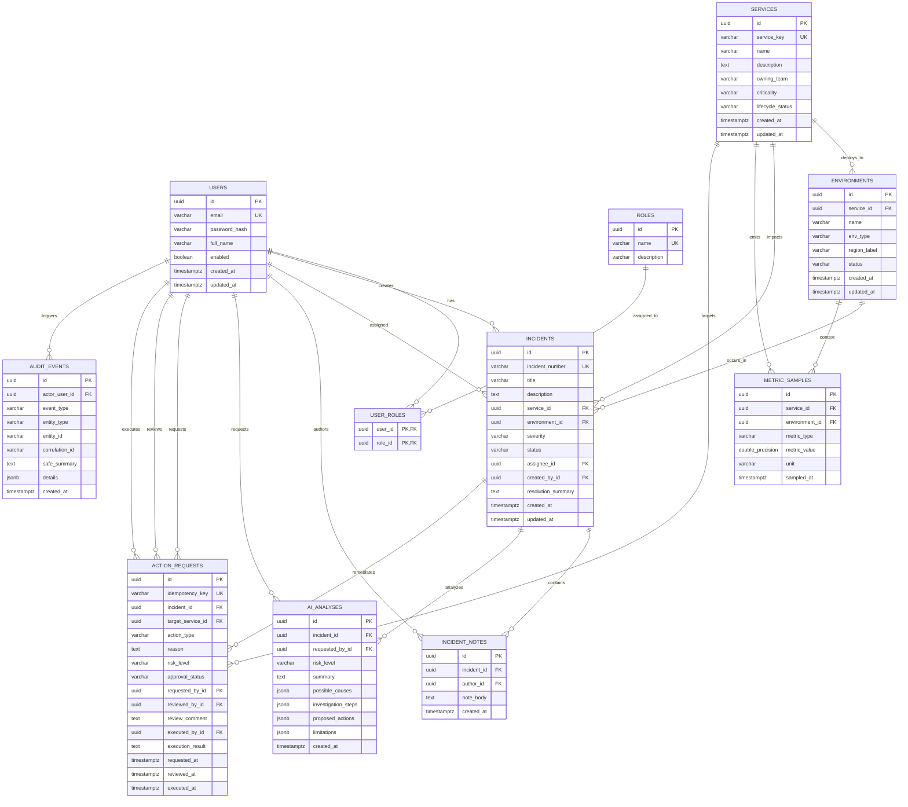

# ForgeOps Database Design & Schema Specification

## 1. Entity-Relationship Diagram (ERD)

---

## 2. Table Specifications & Constraints

### 2.1 `users`
- `id`: `UUID PRIMARY KEY DEFAULT gen_random_uuid()`
- `email`: `VARCHAR(255) NOT NULL UNIQUE`
- `password_hash`: `VARCHAR(255) NOT NULL` (BCrypt hash)
- `full_name`: `VARCHAR(150) NOT NULL`
- `enabled`: `BOOLEAN NOT NULL DEFAULT TRUE`
- `created_at`: `TIMESTAMPTZ NOT NULL DEFAULT CURRENT_TIMESTAMP`
- `updated_at`: `TIMESTAMPTZ NOT NULL DEFAULT CURRENT_TIMESTAMP`

### 2.2 `roles`
- `id`: `UUID PRIMARY KEY DEFAULT gen_random_uuid()`
- `name`: `VARCHAR(50) NOT NULL UNIQUE` (Values: `ROLE_VIEWER`, `ROLE_ENGINEER`, `ROLE_APPROVER`, `ROLE_ADMIN`)
- `description`: `VARCHAR(255)`

### 2.3 `user_roles`
- `user_id`: `UUID NOT NULL REFERENCES users(id) ON DELETE CASCADE`
- `role_id`: `UUID NOT NULL REFERENCES roles(id) ON DELETE RESTRICT`
- `PRIMARY KEY (user_id, role_id)`

### 2.4 `services`
- `id`: `UUID PRIMARY KEY DEFAULT gen_random_uuid()`
- `service_key`: `VARCHAR(64) NOT NULL UNIQUE` (e.g., `orders-api`, `identity-service`)
- `name`: `VARCHAR(128) NOT NULL`
- `description`: `TEXT`
- `owning_team`: `VARCHAR(100) NOT NULL`
- `criticality`: `VARCHAR(20) NOT NULL` (CHECK: `LOW`, `MEDIUM`, `HIGH`, `CRITICAL`)
- `lifecycle_status`: `VARCHAR(30) NOT NULL DEFAULT 'ACTIVE'` (CHECK: `ACTIVE`, `MAINTENANCE`, `DECOMMISSIONED`)
- `created_at`: `TIMESTAMPTZ NOT NULL DEFAULT CURRENT_TIMESTAMP`
- `updated_at`: `TIMESTAMPTZ NOT NULL DEFAULT CURRENT_TIMESTAMP`

### 2.5 `environments`
- `id`: `UUID PRIMARY KEY DEFAULT gen_random_uuid()`
- `service_id`: `UUID NOT NULL REFERENCES services(id) ON DELETE CASCADE`
- `name`: `VARCHAR(64) NOT NULL` (e.g. `Production`, `Staging`, `Development`)
- `env_type`: `VARCHAR(30) NOT NULL` (e.g. `PRODUCTION`, `STAGING`, `DEVELOPMENT`)
- `region_label`: `VARCHAR(50) NOT NULL` (e.g. `us-east-1 (simulated)`)
- `status`: `VARCHAR(30) NOT NULL DEFAULT 'HEALTHY'` (CHECK: `HEALTHY`, `DEGRADED`, `UNAVAILABLE`, `UNKNOWN`)
- `created_at`: `TIMESTAMPTZ NOT NULL DEFAULT CURRENT_TIMESTAMP`
- `updated_at`: `TIMESTAMPTZ NOT NULL DEFAULT CURRENT_TIMESTAMP`
- `CONSTRAINT uk_service_env UNIQUE (service_id, name)`

### 2.6 `incidents`
- `id`: `UUID PRIMARY KEY DEFAULT gen_random_uuid()`
- `incident_number`: `VARCHAR(32) NOT NULL UNIQUE` (e.g., `INC-2026-0001`)
- `title`: `VARCHAR(255) NOT NULL`
- `description`: `TEXT NOT NULL`
- `service_id`: `UUID NOT NULL REFERENCES services(id) ON DELETE RESTRICT`
- `environment_id`: `UUID NOT NULL REFERENCES environments(id) ON DELETE RESTRICT`
- `severity`: `VARCHAR(10) NOT NULL` (CHECK: `SEV1`, `SEV2`, `SEV3`, `SEV4`)
- `status`: `VARCHAR(20) NOT NULL DEFAULT 'OPEN'` (CHECK: `OPEN`, `INVESTIGATING`, `MITIGATED`, `RESOLVED`)
- `assignee_id`: `UUID REFERENCES users(id) ON DELETE SET NULL`
- `created_by_id`: `UUID NOT NULL REFERENCES users(id) ON DELETE RESTRICT`
- `resolution_summary`: `TEXT` (Must be provided when status reaches `RESOLVED`)
- `created_at`: `TIMESTAMPTZ NOT NULL DEFAULT CURRENT_TIMESTAMP`
- `updated_at`: `TIMESTAMPTZ NOT NULL DEFAULT CURRENT_TIMESTAMP`

### 2.7 `incident_notes`
- `id`: `UUID PRIMARY KEY DEFAULT gen_random_uuid()`
- `incident_id`: `UUID NOT NULL REFERENCES incidents(id) ON DELETE CASCADE`
- `author_id`: `UUID NOT NULL REFERENCES users(id) ON DELETE RESTRICT`
- `note_body`: `TEXT NOT NULL`
- `created_at`: `TIMESTAMPTZ NOT NULL DEFAULT CURRENT_TIMESTAMP`

### 2.8 `metric_samples`
- `id`: `UUID PRIMARY KEY DEFAULT gen_random_uuid()`
- `service_id`: `UUID NOT NULL REFERENCES services(id) ON DELETE CASCADE`
- `environment_id`: `UUID NOT NULL REFERENCES environments(id) ON DELETE CASCADE`
- `metric_type`: `VARCHAR(30) NOT NULL` (CHECK: `CPU_UTILIZATION`, `MEMORY_UTILIZATION`, `LATENCY_P95`, `ERROR_RATE`)
- `metric_value`: `DOUBLE PRECISION NOT NULL`
- `unit`: `VARCHAR(20) NOT NULL` (e.g. `%`, `ms`, `req/s`)
- `sampled_at`: `TIMESTAMPTZ NOT NULL DEFAULT CURRENT_TIMESTAMP`

### 2.9 `ai_analyses`
- `id`: `UUID PRIMARY KEY DEFAULT gen_random_uuid()`
- `incident_id`: `UUID NOT NULL REFERENCES incidents(id) ON DELETE CASCADE`
- `requested_by_id`: `UUID NOT NULL REFERENCES users(id) ON DELETE RESTRICT`
- `risk_level`: `VARCHAR(20) NOT NULL` (CHECK: `LOW`, `MEDIUM`, `HIGH`, `CRITICAL`)
- `summary`: `TEXT NOT NULL`
- `possible_causes`: `JSONB NOT NULL` (List of strings)
- `investigation_steps`: `JSONB NOT NULL` (List of strings)
- `proposed_actions`: `JSONB NOT NULL` (List of structured action objects)
- `limitations`: `JSONB NOT NULL` (List of strings)
- `created_at`: `TIMESTAMPTZ NOT NULL DEFAULT CURRENT_TIMESTAMP`

### 2.10 `action_requests`
- `id`: `UUID PRIMARY KEY DEFAULT gen_random_uuid()`
- `idempotency_key`: `VARCHAR(64) NOT NULL UNIQUE`
- `incident_id`: `UUID NOT NULL REFERENCES incidents(id) ON DELETE RESTRICT`
- `target_service_id`: `UUID NOT NULL REFERENCES services(id) ON DELETE RESTRICT`
- `action_type`: `VARCHAR(50) NOT NULL` (CHECK: `MARK_SERVICE_MAINTENANCE`, `CLEAR_DEMO_ALERT`, `RESTART_DEMO_SERVICE`)
- `reason`: `TEXT NOT NULL`
- `risk_level`: `VARCHAR(20) NOT NULL` (CHECK: `LOW`, `MEDIUM`, `HIGH`, `CRITICAL`)
- `approval_status`: `VARCHAR(30) NOT NULL DEFAULT 'PENDING_APPROVAL'` (CHECK: `PENDING_APPROVAL`, `APPROVED`, `REJECTED`, `EXECUTED`, `FAILED`)
- `requested_by_id`: `UUID NOT NULL REFERENCES users(id) ON DELETE RESTRICT`
- `reviewed_by_id`: `UUID REFERENCES users(id) ON DELETE RESTRICT`
- `review_comment`: `TEXT`
- `executed_by_id`: `UUID REFERENCES users(id) ON DELETE RESTRICT`
- `execution_result`: `TEXT`
- `requested_at`: `TIMESTAMPTZ NOT NULL DEFAULT CURRENT_TIMESTAMP`
- `reviewed_at`: `TIMESTAMPTZ`
- `executed_at`: `TIMESTAMPTZ`

### 2.11 `audit_events`
- `id`: `UUID PRIMARY KEY DEFAULT gen_random_uuid()`
- `actor_user_id`: `UUID REFERENCES users(id) ON DELETE SET NULL`
- `event_type`: `VARCHAR(64) NOT NULL`
- `entity_type`: `VARCHAR(64) NOT NULL`
- `entity_id`: `VARCHAR(64) NOT NULL`
- `correlation_id`: `VARCHAR(64)`
- `safe_summary`: `TEXT NOT NULL`
- `details`: `JSONB`
- `created_at`: `TIMESTAMPTZ NOT NULL DEFAULT CURRENT_TIMESTAMP`

---

## 3. Indexes & Performance Optimization

- `CREATE INDEX idx_services_key ON services(service_key);`
- `CREATE INDEX idx_incidents_status_severity ON incidents(status, severity);`
- `CREATE INDEX idx_incidents_service ON incidents(service_id);`
- `CREATE INDEX idx_incidents_assignee ON incidents(assignee_id);`
- `CREATE INDEX idx_metric_samples_svc_time ON metric_samples(service_id, sampled_at DESC);`
- `CREATE INDEX idx_action_requests_status ON action_requests(approval_status);`
- `CREATE INDEX idx_audit_events_created ON audit_events(created_at DESC);`
- `CREATE INDEX idx_audit_events_actor ON audit_events(actor_user_id);`

---

## 4. Flyway Migrations Plan

1. `V1__init_schema.sql`: Base tables (`users`, `roles`, `user_roles`, `services`, `environments`).
2. `V2__incidents_and_metrics.sql`: Tables (`incidents`, `incident_notes`, `metric_samples`).
3. `V3__ai_and_approvals.sql`: Tables (`ai_analyses`, `action_requests`, `audit_events`).
4. `V4__seed_demo_data.sql`: Controlled initial demo dataset with password hashes for:
   - `viewer@forgeops.local` (Role: `ROLE_VIEWER`)
   - `engineer@forgeops.local` (Role: `ROLE_ENGINEER`)
   - `approver@forgeops.local` (Role: `ROLE_APPROVER`)
   - `admin@forgeops.local` (Role: `ROLE_ADMIN`)
   - Seed services: `orders-api`, `identity-service`, `notification-worker`, `billing-api`, `inventory-service`
